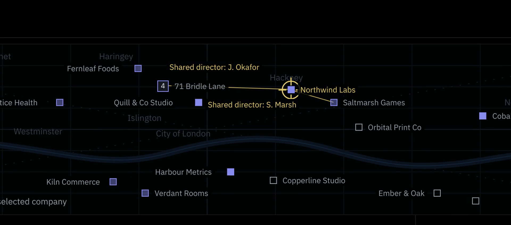
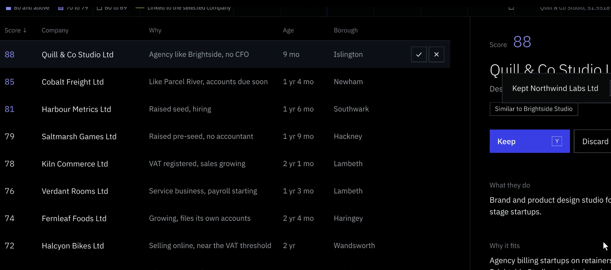
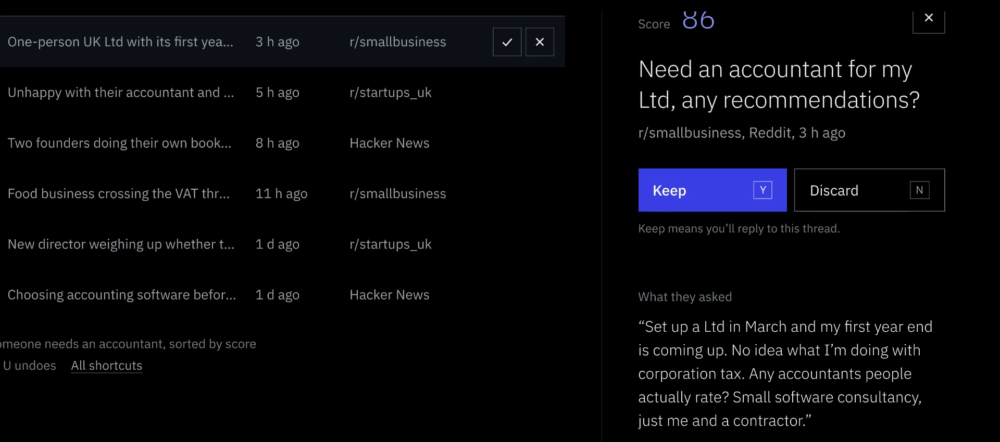
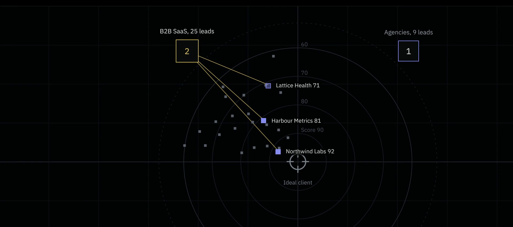
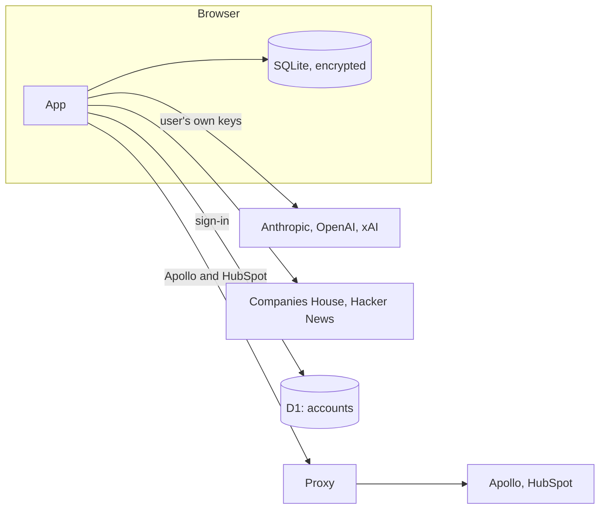

# Sleuthhound

[](https://github.com/bheant/sleuthhound/actions/workflows/ci.yml)

Lead generation for UK B2B sales. Sleuthhound pulls newly registered companies from multiple data sources and relevant forum posts, uses an LLM to score each one against your existing clients, and keeps all of it in the browser.

Live at [sleuthhound.net](https://sleuthhound.net/sample). The sample workspace works without an account.

https://github.com/user-attachments/assets/697ae84b-1745-4a0d-8112-4bb3fe5ea044


## Background

I built Sleuthhound for an accounting firm that wanted a regular list of young UK companies to contact. Client lists and lead notes are commercially sensitive, so I made the app local-first: the data is stored and processed in the browser, encrypted with a key derived from the user's password. The server handles accounts and nothing else. It runs on Cloudflare Pages and D1.

## Features

- Scheduled runs that fetch new companies from Companies House and posts from Hacker News, then add directors, registered office, borough and filing deadlines to each company.
- An LLM review of every lead (Claude, GPT or Grok, using the user's own API key) with a 0 to 100 score, a short reason and the sources it relied on.
- A client list upload (CSV) that produces the ideal-client description used for scoring, and a lookalike search for each client.
- A review queue built for the keyboard: `Y` keeps, `N` discards, `U` undoes. Kept companies can be sent to HubSpot, and directors' emails looked up in Apollo.
- A wizard for adding sources, including arbitrary CSV files, mapped onto one shared data model.
- Source links on every fact, and the model name and time on every AI review.

## Screenshots

| | |
| --- | --- |
|  |  |
|  |  |

## Where the data lives



Leads, sources, notes, files and API keys are held in a SQLite database (sql.js) in the browser and saved to IndexedDB as a single AES-256-GCM snapshot. The password is stretched with PBKDF2 (600,000 rounds) and split with HKDF into a sign-in key and a vault key; only the sign-in key reaches the server, and only as a salted hash.

The browser calls Anthropic, OpenAI, xAI and Companies House directly. Apollo and HubSpot don't allow browser requests, so those go through a Pages Function that checks the session, forwards five headers and stores nothing.

The accounts database holds names, emails, log-in times and two wrapped copies of each user's data key, neither of which the server can open. [docs/security.md](docs/security.md) covers the threat model, including what this design doesn't protect against.

## Technical notes

- All sources map into one schema of targets, signals, people, places, sources and links. Company numbers and SIC codes stay inside the Companies House connector. ([ADR 4](docs/adr/0004-one-ontology-for-every-source.md))
- The three LLM providers sit behind one interface on the Vercel AI SDK. Every response is validated with Zod, and cited URLs are checked against what the research step returned.
- Runs execute in the open tab. Requests to Companies House share a rate limiter (600 requests per 5 minutes), and each pipeline step logs its own errors instead of failing the run.
- The Content-Security-Policy is generated at build time from hashes of the inline scripts Next.js emits.
- The map, connections graph, deadline timeline and client chart are plain SVG in React.
- Vitest covers the pure logic and runs the account functions against the real D1 schema.
- The app is installable as a PWA and works offline.

More detail in [docs/architecture.md](docs/architecture.md) and the decision records in [docs/adr](docs/adr).

## Stack

Next.js 16 (static export), React 19, TypeScript, Tailwind CSS, sql.js, Drizzle, Dexie, WebCrypto, Vercel AI SDK, Zod, Cloudflare Pages Functions and D1, Vitest.

## Running locally

Requires Node 20 or later.

```bash
npm install
npm run dev
```

The app runs on http://127.0.0.1:3000, with the account functions and a local D1 on port 8788. Create an invite with `npm run invite -- --local`, sign up from the link, then add a Companies House key and an LLM key under Connections.

The scoring rubric in this repository is a simplified version. The production rubric is tuned on real keep and discard decisions and is kept private, so local scores will be rougher.

```bash
npm run typecheck
npm run lint
npm test
npm run build
```

Deployment steps are in [docs/deploy.md](docs/deploy.md).

## Limitations

- Reddit support is built but waiting on Reddit's approval for commercial API access.
- Data is per browser. Moving to another device means exporting and importing an encrypted backup.
- Runs only happen while the app is open; missed schedules run on the next unlock.
- Coverage is UK only, and the rubric is written for an accounting firm.

## Contact

Accounts are invite-only. For access, or to have it set up for your business, email contact@sleuthhound.net.

## Licence

[PolyForm Noncommercial 1.0.0](LICENSE.md). Free to read, run and modify for noncommercial use.
